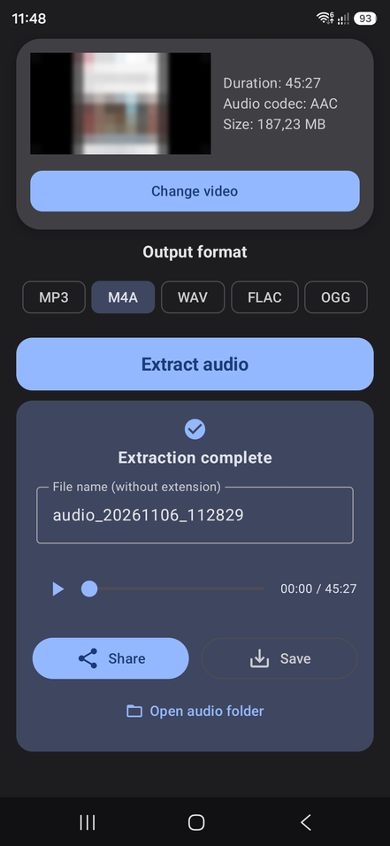

# AudioPeel

[](LICENSE)
[](https://github.com/rustyx/AudioPeel/releases/latest)
[](https://github.com/rustyx/AudioPeel/releases)
[](https://github.com/rustyx/AudioPeel/releases/latest)

[English](README.md) | [简体中文](README.zh-CN.md)

> Fork of [tianxing-ovo/AudioPeel](https://github.com/tianxing-ovo/AudioPeel) with an English UI, Traditional Chinese, per-app language selection and a cleaned-up build setup.

A lightweight Android video-to-audio tool that exports to MP3 / M4A / WAV / FLAC / OGG

## Features

- **Video picker** — Select a video without requesting storage read/write permission
- **Video info** — Shows ⌈thumbnail/duration/audio codec/file size⌋ after selection and supports fullscreen preview on tap
- **Multiple formats** — Supports MP3 / M4A / WAV / FLAC / OGG
- **Smart suggestion** — Detects embedded audio codec and suggests a suitable output format
- **Fast extraction** — Reads the video directly to reduce copying and stream-copies the audio track when codecs match for faster extraction
- **Progress & cancel** — Shows circular progress with percentage and supports canceling extraction
- **Audio preview** — Preview the extracted audio after extraction succeeds
- **File management** — Supports renaming and saving to `/Music/AudioPeel` and opening the audio folder
- **Share** — Supports sharing to apps such as ⌈WeChat/QQ/Telegram⌋
- **Languages** — English, Simplified Chinese and Traditional Chinese; on Android 13+ the app language can be chosen in system settings independently of the device language

## Quick Start

### Requirements

- Android 7.0 or later (API 24)

### Install

1. Download the latest APK from [Releases](https://github.com/rustyx/AudioPeel/releases/latest)
   - Use `arm64-v8a` on most Android phones
   - Use `x86_64` on emulators
2. Install and open the app
   - This fork is signed with a different key than the original app, so uninstall the original (音频提取器) first if it is installed
3. Pick a video and confirm the output format before extracting

## Screenshots



## Tech Stack

|       Area       |                            Choice                             |
|:----------------:|:-------------------------------------------------------------:|
|     Language     |                          100% Kotlin                          |
|        UI        |      Jetpack Compose + Material Design 3 + Edge-to-Edge       |
| Media processing |                           FFmpegKit                           |
|  Audio playback  |                   AndroidX Media3 ExoPlayer                   |
|  Media probing   |          `MediaExtractor` + `MediaMetadataRetriever`          |
|   Architecture   |                      MVVM + `StateFlow`                       |
|       Size       | R8 + resource shrinking + ABI and locale filters (`arm64-v8a`, `x86_64`; `en`, `zh`) |

## Build

### Prerequisites

1. **Android Studio** (a recent stable release recommended)
2. **Java 17+** (compatible with the project Gradle version)
3. **Android SDK** (`minSdk` 24, `compileSdk` / `targetSdk` 37)

### Steps

1. Clone the repository:
   ```bash
   git clone https://github.com/rustyx/AudioPeel.git
   ```
2. Open the project root in Android Studio
3. Wait for Gradle sync
4. Connect a device or emulator
5. Run `Run 'app'` or `./gradlew assembleDebug`

To build from the command line without Android Studio, point Gradle at your SDK via `ANDROID_HOME` or `sdk.dir=/path/to/Android/Sdk` in `local.properties` (not committed).

### Release signing

`./gradlew assembleRelease` produces signed APKs when these properties are set, e.g. in `~/.gradle/gradle.properties` (never in the repository):

```properties
AUDIOPEEL_STORE_FILE=/path/to/release.jks
AUDIOPEEL_STORE_PASSWORD=...
AUDIOPEEL_KEY_ALIAS=...
AUDIOPEEL_KEY_PASSWORD=...
```

On CI, pass them as `ORG_GRADLE_PROJECT_AUDIOPEEL_*` environment variables. Without them, release APKs are left unsigned.

## Permissions

|                 Note                  |                         Detail                         |
|:-------------------------------------:|:------------------------------------------------------:|
|         No storage permission         | Picking a video needs no storage read/write permission |
|         No network permission         |      Fully offline processing with no data upload      |
| No background/notification permission |                     Not requested                      |

## Contributing

Issues and Pull Requests are welcome

1. Fork this repository
2. Create a feature branch and commit your changes
3. Push and open a Pull Request

## License

This project is released under the [MIT License](LICENSE)
