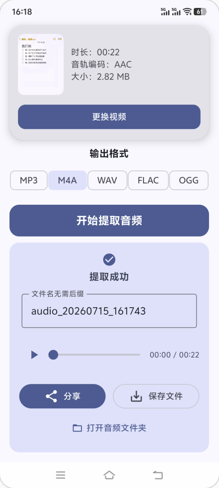

# 音频提取器 [AudioPeel]

[](LICENSE)
[](https://github.com/rustyx/AudioPeel/releases/latest)
[](https://github.com/rustyx/AudioPeel/releases)
[](https://github.com/rustyx/AudioPeel/releases/latest)

[English](README.md) | [简体中文](README.zh-CN.md)

> 本项目 Fork 自 [tianxing-ovo/AudioPeel](https://github.com/tianxing-ovo/AudioPeel)，新增英文界面、繁体中文、应用内语言选择，并整理了构建配置。

一款轻量级 Android 视频转音频工具支持导出为 MP3 / M4A / WAV / FLAC / OGG

## 功能特性

- **视频选择** — 选择视频无需申请存储读写权限
- **视频信息** — 选中后展示⌈缩略图/时长/音轨编码/文件大小⌋并支持点击全屏预览
- **多格式输出** — 支持 MP3 / M4A / WAV / FLAC / OGG
- **智能推荐** — 自动检测内嵌音频编码并推荐最佳输出格式
- **快速提取** — 直接读取视频减少拷贝并在编码匹配时流复制音轨以加快提取
- **进度与取消** — 提供环形进度与百分比显示并支持取消提取
- **试听预览** — 提取成功后可试听音频
- **文件管理** — 支持重命名并保存至 `/Music/AudioPeel` 且可打开音频文件夹
- **分享** — 支持分享到⌈微信/QQ/Telegram⌋等应用
- **多语言** — 支持英文、简体中文和繁体中文；Android 13 及以上可在系统设置中单独选择应用语言

## 快速开始

### 前提条件

- Android 7.0 及以上（API 24）

### 安装步骤

1. 从 [Releases](https://github.com/rustyx/AudioPeel/releases/latest) 下载最新 APK
   - 普通 Android 手机请选择 `arm64-v8a`
   - 模拟器请选择 `x86_64`
2. 安装并打开应用
   - 本 Fork 使用的签名与原版不同，如已安装原版（音频提取器）请先卸载
3. 选择视频并确认输出格式后开始提取

## 截图展示



## 技术栈与架构

|    模块    |                      技术选型                      |
|:----------:|:--------------------------------------------------:|
|  开发语言  |                    100% Kotlin                     |
|  UI 框架   | Jetpack Compose + Material Design 3 + Edge-to-Edge |
| 多媒体处理 |                     FFmpegKit                      |
|  音频引擎  |             AndroidX Media3 ExoPlayer              |
|  媒体探测  |    `MediaExtractor` + `MediaMetadataRetriever`     |
|  架构模式  |                 MVVM + `StateFlow`                 |
|  包体优化  | R8 + 资源压缩 + ABI 与语言过滤（`arm64-v8a`、`x86_64`；`en`、`zh`） |

## 本地编译

### 环境依赖

1. **Android Studio**（建议使用较新的稳定版）
2. **Java 17+**（需与当前 Gradle 版本兼容）
3. **Android SDK**（`minSdk` 24，`compileSdk` / `targetSdk` 37）

### 编译步骤

1. 克隆仓库：
   ```bash
   git clone https://github.com/rustyx/AudioPeel.git
   ```
2. 用 Android Studio 打开项目根目录
3. 等待 Gradle 同步完成
4. 连接真机或模拟器
5. 运行 `Run 'app'` 或执行 `./gradlew assembleDebug`

如需不借助 Android Studio 在命令行编译，请通过 `ANDROID_HOME` 环境变量或 `local.properties` 中的 `sdk.dir=/path/to/Android/Sdk`（该文件不提交）指定 SDK 路径。

### 发布签名

设置以下属性后，`./gradlew assembleRelease` 会生成已签名的 APK。属性可写在 `~/.gradle/gradle.properties` 中（切勿提交到仓库）：

```properties
AUDIOPEEL_STORE_FILE=/path/to/release.jks
AUDIOPEEL_STORE_PASSWORD=...
AUDIOPEEL_KEY_ALIAS=...
AUDIOPEEL_KEY_PASSWORD=...
```

在 CI 中可通过 `ORG_GRADLE_PROJECT_AUDIOPEEL_*` 环境变量传入。未设置时生成未签名的 APK。

## 权限说明

|      说明       |           详情           |
|:---------------:|:------------------------:|
|   无存储权限    | 选视频不需要存储读写权限 |
|   无网络权限    |    本地处理不上传数据    |
| 无后台/通知权限 | 不申请后台运行或通知权限 |

## 参与贡献

欢迎提交 Issue 和 Pull Request

1. Fork 本仓库
2. 创建功能分支并提交更改
3. 推送后发起 Pull Request

## 许可证

本项目基于 [MIT License](LICENSE) 开源
